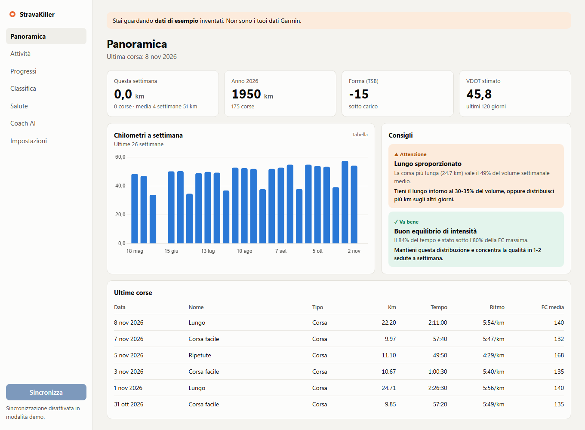
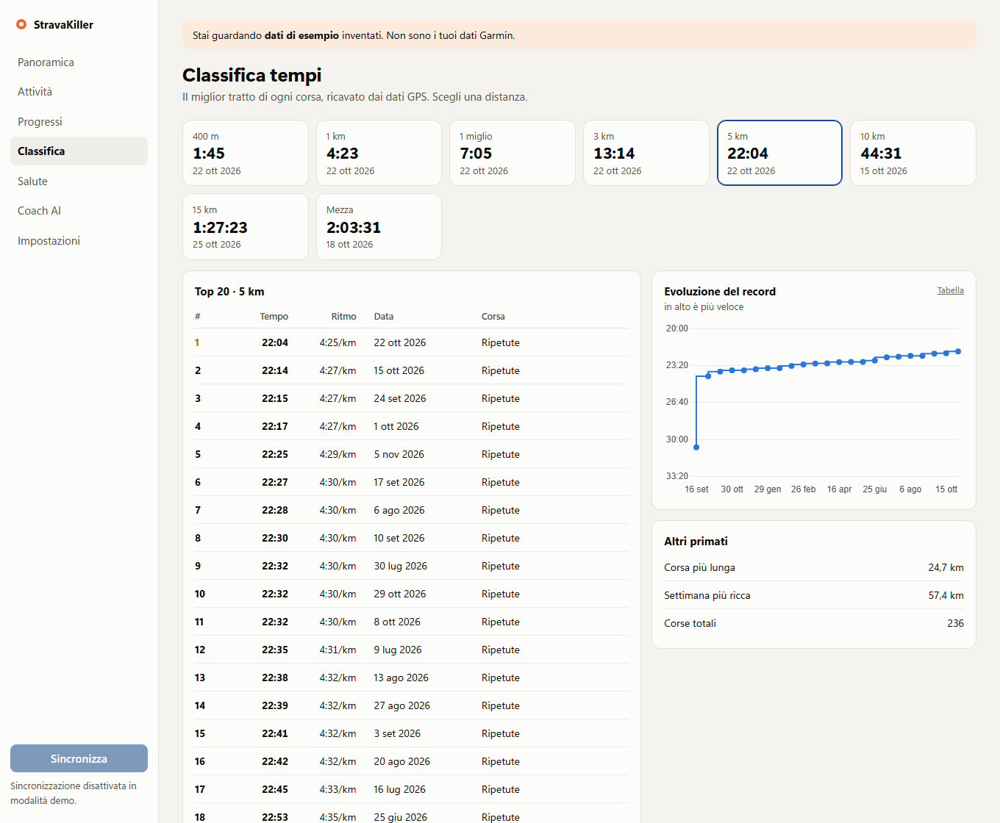
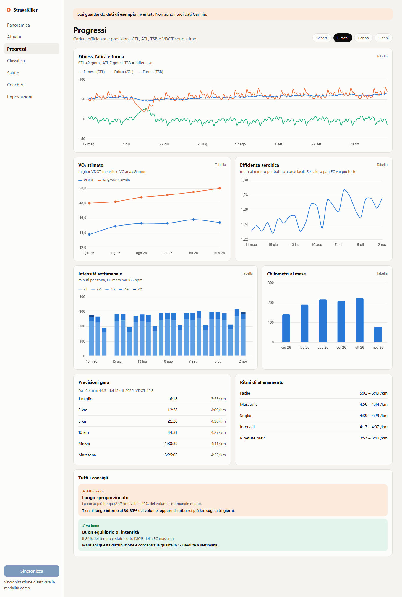
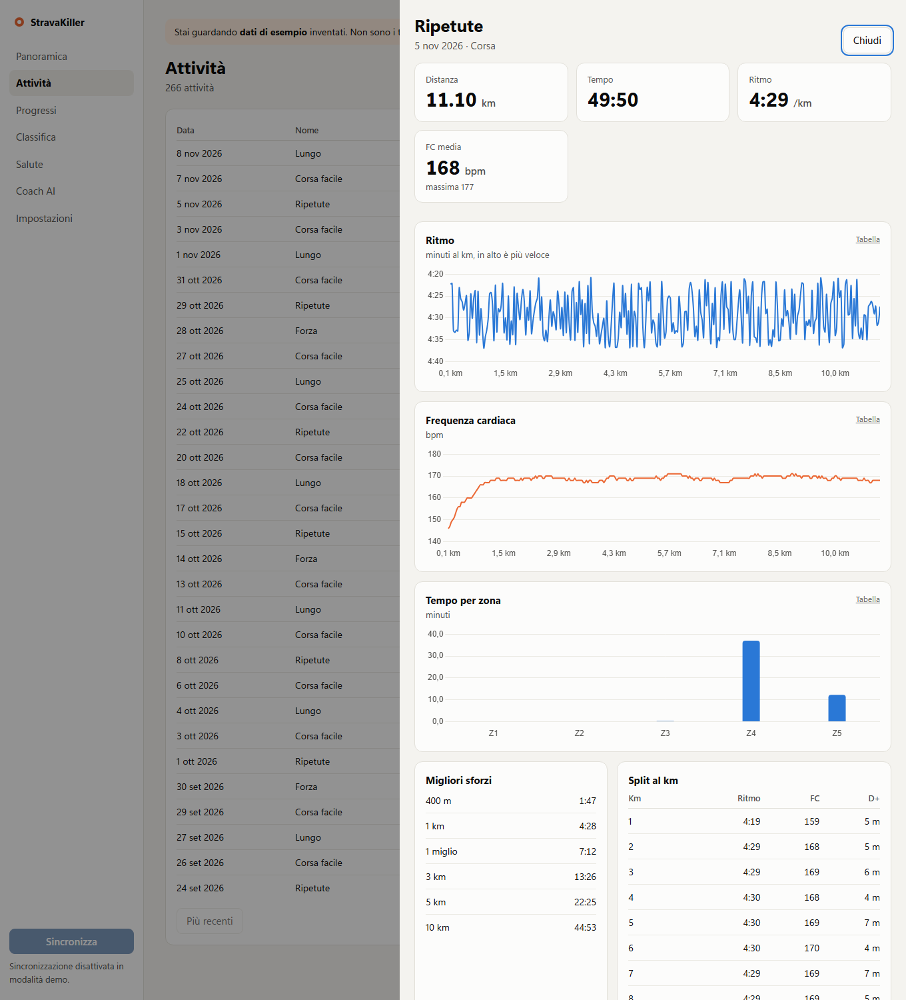
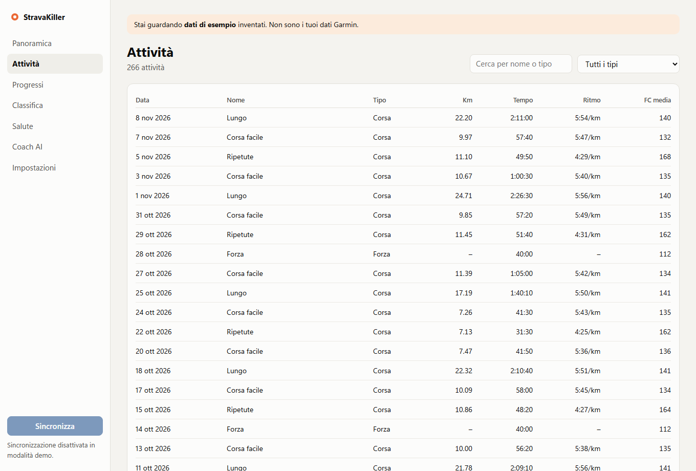
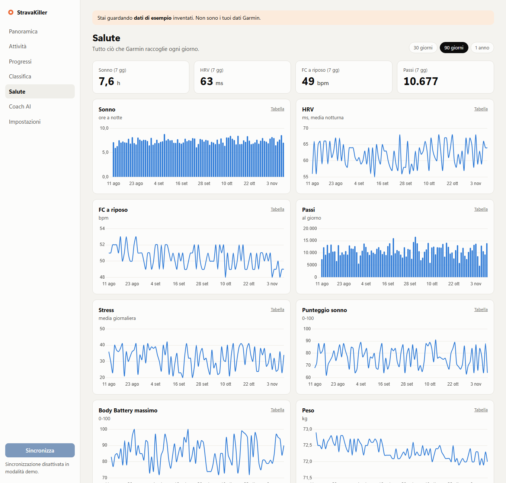
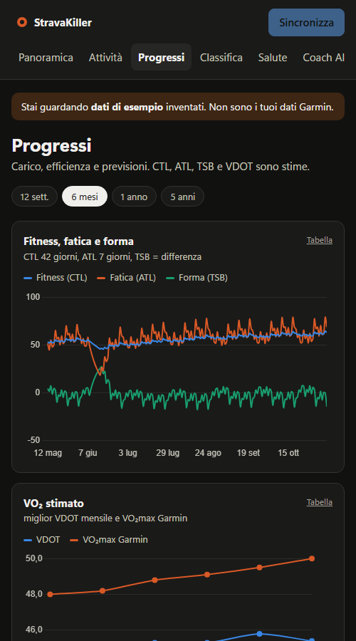
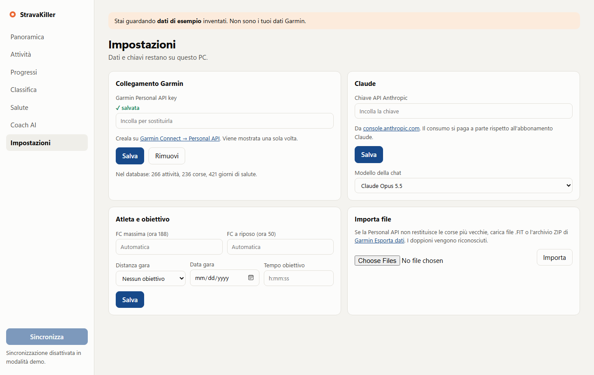

<div align="center">

# 🪦 StravaKiller

### Ho appena ucciso Strava.
*(Sul mio portatile. Con un doppio clic. Strava sta benissimo. La mia ansia da abbonamento no.)*

**I tuoi dati Garmin. Il tuo computer. Un coach AI che i tuoi split li ha letti davvero.**

**Niente feed. Niente kudos. Niente pubblicità. Niente account. Nessuno che guarda la tua corsetta di recupero del martedì.**

[🇬🇧 Read in English](README.md) · [Guardala](#-guardala) · [Provala in 5 minuti](#-provala-in-5-minuti) · [Collega l'orologio](#-collega-il-tuo-garmin) · [Glossario](#-cosa-vogliono-dire-tutte-queste-sigle)



</div>

> [!IMPORTANT]
> **Stato onesto: appena sfornata.** Dashboard, analisi e demo funzionano e sono testate. La sincronizzazione con Garmin e la chat AI sono state provate solo contro servizi simulati, quindi **la prima sincronizzazione reale può riservare sorprese**. Se succede, [apri una issue](../../issues).

> [!NOTE]
> "StravaKiller" è uno scherzo. Questo progetto è indipendente e **non è affiliato, approvato o collegato a Strava o Garmin**. Servono un account Garmin e una tua chiave API personale.

---

## 🤔 Che cos'è?

Il tuo orologio Garmin raccoglie una quantità assurda di dati su di te. StravaKiller scarica **i tuoi dati** sul **tuo computer** e li trasforma in qualcosa di utile:

- 🏆 **Una classifica contro l'unica persona che conta:** te stesso nel passato. Trova i tuoi migliori 400 m, 1 km, 5 km, 10 km, mezza e maratona *dentro qualsiasi corsa*.
- 📈 **Progressi che si vedono:** fitness, fatica, forma, efficienza aerobica e intensità nel tempo.
- 🔮 **Previsioni gara e ritmi di allenamento** calcolati dalle tue prestazioni recenti.
- 💡 **Consigli con le prove:** ogni suggerimento mostra il numero che l'ha generato. Niente "grande campione!" generici.
- 😴 **La salute in un solo posto:** sonno, HRV, frequenza cardiaca a riposo, passi, stress, Body Battery e peso.
- 🤖 **Un coach AI (Claude)** che legge i tuoi dati prima di rispondere. Chiedi *"mi sto allenando troppo?"* e la risposta contiene i tuoi numeri.

### Il riassunto in una tabella

| | Una tipica app social per lo sport | StravaKiller |
|---|---|---|
| Dove stanno i dati | Sui loro server | **In un file sul tuo PC** |
| Chi vede le tue corse | Chi permettono le impostazioni | **Tu** |
| Pubblicità e feed | Spesso | **Mai. Il feed non esiste.** |
| Abbonamento mensile | Spesso | **Nessuno.** La chat AI, facoltativa, si paga a consumo |
| Puoi leggere il codice? | No | **Ogni riga** |
| Kudos | Sì | **Puoi dartene uno da solo. Non lo saprà nessuno.** |

---

## 👀 Guardala

> Tutti gli screenshot usano **dati di esempio inventati**. Non sono le corse di nessuno.

### 🏆 Classifica: tu contro te
I migliori tempi per ogni distanza, la top 20 e la storia di ogni record battuto.



### 📈 Progressi: la pagina del "sto migliorando?"
Fitness, fatica, forma, VO₂ stimato, efficienza, intensità, previsioni gara, ritmi di allenamento e tutti i consigli.



### 🔍 Ogni corsa, ai raggi X
Ritmo, frequenza cardiaca, tempo per zona, migliori sforzi e split al chilometro.



### 📋 Tutte le attività
Cerca e filtra tutto, comprese le attività che non sono corsa.



### 😴 Salute
Tutto ciò che il tuo orologio misura ogni giorno.



### 🌙 Tema scuro e schermi piccoli
Segue il tema del sistema e si adatta agli schermi stretti.



### ⚙️ Impostazioni
Qui incolli le chiavi e imposti l'obiettivo gara.



### 🤖 Il coach AI
Qui lo screenshot manca di proposito: serve una chiave API vera, e una chat finta sarebbe barare. Cosa puoi chiedergli:

- *"Come sta andando il mio allenamento?"*
- *"Preparami la prossima settimana in base a quello che ho fatto davvero."*
- *"Sono a rischio sovraccarico?"*
- *"Come posso migliorare sui 10 km?"*

Ha accesso **in sola lettura**: può guardare i tuoi dati, mai modificarli.

---

## 🚀 Provala in 5 minuti

Non serve un account Garmin: la demo usa dati inventati. Le istruzioni sono per **Windows**, dove è stata testata.

**1. Installa Python.** Premi il tasto Windows, scrivi `PowerShell`, premi Invio e incolla:

```bash
winget install Python.Python.3.13 --scope user
```

**2. Scarica il progetto.** In cima a questa pagina clicca il pulsante verde **Code** → **Download ZIP**. Poi estrai lo ZIP (tasto destro → *Estrai tutto*) in un posto semplice, come Documenti. Evita le cartelle sincronizzate da OneDrive o Dropbox.

**3. Avvia la demo.** Apri la cartella estratta, clicca sulla barra dell'indirizzo, scrivi `powershell` e premi Invio. Poi incolla:

```bash
powershell -ExecutionPolicy Bypass -File start.ps1 -Demo
```

Il primo avvio installa ciò che serve e richiede qualche minuto. Poi il browser si apre su `http://127.0.0.1:8765`. 🎉

Tieni aperta quella finestra mentre usi l'app. Chiudila per fermarla.

---

## ⌚ Collega il tuo Garmin

**1. Crea la tua chiave personale.** È gratis e non serve alcuna approvazione.
- Vai su [Garmin Connect → Personal API](https://connect.garmin.com/app/settings/personalApiToken) e accedi.
- Crea una chiave, leggi e accetta i termini, e scegli la durata (fino a 1 anno).
- **Copiala subito: Garmin la mostra una sola volta.**

Trattala come una password: non pubblicarla, non metterla nel codice, non incollarla nelle chat.

**2. Avvia l'app reale.** Doppio clic su **`Start StravaKiller.bat`**.

**3. Incolla la chiave** in **Impostazioni** e clicca **Salva**.

**4. Clicca Sincronizza** in basso a sinistra e vai a farti un caffè. La prima volta legge tutte le attività e due anni di salute, e analizza fino a 400 corse. Sincronizza di nuovo per elaborare le altre.

**Mancano le corse più vecchie?** Nelle Impostazioni puoi importare file `.FIT` o lo ZIP dell'[esportazione dati](https://www.garmin.com/account/datamanagement/) di Garmin. I doppioni vengono riconosciuti.

### 🤖 Attiva il coach AI (facoltativo)

1. Crea una chiave API su [console.anthropic.com](https://console.anthropic.com/settings/keys).
2. Incollala in **Impostazioni**, nella sezione *Claude*.
3. Apri **Coach AI** e chiedi quello che vuoi.

L'API si **paga a consumo, separatamente da qualsiasi abbonamento Claude**. Vedi i [prezzi aggiornati](https://www.anthropic.com/pricing). Nelle Impostazioni puoi scegliere un modello più economico.

### 💬 Chiedi da Claude Code (facoltativo)

Il progetto include un server [MCP](https://modelcontextprotocol.io) in sola lettura. Copia `.mcp.example.json` in `.mcp.json`, sostituisci i due percorsi con i tuoi e apri la cartella in Claude Code.

---

## 🧠 Cosa vogliono dire tutte queste sigle?

Non ne hai mai sentita una? Perfetto. Ecco la versione breve.

| Termine | In parole semplici |
|---|---|
| **Chiave API** | Una lunga password che permette a questa app di leggere i tuoi dati Garmin. Deve averla solo tu. |
| **File FIT** | Il file che l'orologio registra per ogni attività, con posizione, frequenza cardiaca e ritmo ogni pochi secondi. |
| **Zone cardiache (Z1–Z5)** | Quanto stai faticando, da "riesco a chiacchierare" (Z1) a "non riesco a parlare" (Z5). |
| **Carico di allenamento** | Quanto una corsa ha stressato il corpo. Lunga e dura = numero alto. |
| **CTL (Fitness)** | Il carico medio di circa 6 settimane. Sale piano se ti alleni con costanza. |
| **ATL (Fatica)** | Il carico medio di circa 1 settimana. Sale in fretta dopo i giorni duri. |
| **TSB (Forma)** | Fitness meno fatica. Molto negativo: sei stanco. Positivo: sei fresco. |
| **VO₂max** | Quanto ossigeno riesce a usare il tuo corpo. La classica misura del "motore" aerobico. |
| **VDOT** | Un punteggio di forma ricavato da una prestazione tipo gara, usato per prevedere i tempi e impostare i ritmi. |
| **Efficienza aerobica** | Quanto vai veloce per ogni battito. Se sale, sei più in forma. |
| **HRV** | La variazione tra un battito e l'altro. Un calo rispetto al *tuo* normale può indicare scarso recupero. |
| **FC a riposo** | La frequenza cardiaca a riposo. Un aumento insolito può indicare fatica o un malanno. |
| **Cadenza** | Passi al minuto. |
| **Split** | Il tempo di un tratto, di solito un chilometro. |
| **MCP** | Uno standard che permette agli assistenti AI di usare strumenti. Qui fa leggere a Claude le tue statistiche. |

---

## 🔬 Come sono calcolati i numeri

Niente scatole nere: è tutto in [`app/analytics.py`](app/analytics.py) e [`app/fit_files.py`](app/fit_files.py).

| Funzione | Metodo |
|---|---|
| Classifica | Finestra scorrevole sui dati FIT per il tratto più veloce; pause escluse, spike GPS scartati |
| Carico | TRIMP di Banister sulla riserva cardiaca |
| CTL / ATL / TSB | Medie esponenziali a 42 e 7 giorni; TSB è CTL − ATL del giorno prima |
| VDOT e previsioni | Formule di Daniels-Gilbert, dal miglior sforzo ≥ 5 km degli ultimi 120 giorni |
| Zone | Percentuale della FC massima, ricalcolate se la cambi |
| Consigli | Regole trasparenti, ognuna mostra il numero che l'ha generata |

Sono **stime per orientare l'allenamento, non indicazioni mediche**. Gli sforzi dentro un allenamento tendono a sottostimare il potenziale in gara. Se qualcosa fa male, vai da un professionista, non su una dashboard.

---

## 🔒 Privacy

- 🏠 Database e chiavi stanno in locale in `%LOCALAPPDATA%\GarminCoach`, mai nella cartella del progetto.
- 🚪 L'app ascolta solo sul tuo computer e rifiuta le richieste da altri siti.
- 📖 L'accesso a Garmin è in sola lettura.
- 📡 I dati escono dal PC solo verso Garmin (per scaricarli) e, **se usi la chat AI**, verso Anthropic (le parti necessarie a risponderti).
- ⚠️ **Su un computer di lavoro**, gli strumenti di rete aziendali possono ispezionare questo traffico. Per i dati di salute personali usa un computer tuo.

---

## 🆘 Qualcosa non va?

| Problema | Cosa fare |
|---|---|
| **`CERTIFICATE_VERIFY_FAILED` durante la sincronizzazione** | Di solito è una rete aziendale che ispeziona il traffico (es. Zscaler). L'app rifiuta la connessione per proteggere la chiave. Usa un computer personale. |
| **"Python non trovato"** | Esegui il passo 1 della demo, poi apri una nuova finestra. |
| **HTTP 401 o 403 da Garmin** | La chiave è sbagliata o scaduta. Creane una nuova e incollala nelle Impostazioni. |
| **HTTP 429 da Garmin** | Troppe richieste. Ciò che è stato scaricato resta salvato; riprova più tardi. |
| **Mancano alcuni grafici** | Garmin potrebbe non fornire quella metrica per il tuo orologio o tramite questa API. |
| **La pagina non si apre** | Controlla che la finestra nera sia aperta e senza errori. La porta 8765 deve essere libera. |
| **Windows avvisa sullo script** | Il codice è tutto qui e puoi leggerlo. Avvialo solo se ti senti tranquillo. |

---

## ⚠️ Limiti noti

- Testata su Windows. Su macOS e Linux dovrebbe funzionare avviando `uvicorn` a mano, ma **non è stata provata** e lo script di avvio è solo PowerShell.
- Pensata per la corsa: gli altri sport compaiono nell'elenco ma non hanno analisi approfondite.
- Sola lettura: non può inviare allenamenti all'orologio, perché l'API personale di Garmin non lo consente.
- Uso personale: ognuno esegue la propria copia con la propria chiave. Non è un servizio online. Leggi i termini di Garmin quando crei la chiave, anche per la parte sull'AI.

---

## 🛠️ Per chi sviluppa

Python · FastAPI · SQLite · JavaScript puro · Chart.js · Anthropic SDK · MCP. **Nessuna build.**

```text
app/
  sync.py        Sincronizzazione Garmin Personal API e import FIT
  fit_files.py   Lettura FIT, migliori sforzi, split, zone
  analytics.py   Metriche, classifica, consigli
  coach.py       Chat Claude in streaming con strumenti
  tools.py       Strumenti di sola lettura per chat e MCP
  mcp_server.py  Server MCP locale
  demo.py        Generatore di dati inventati
  main.py        API locale (solo localhost)
  static/        Interfaccia web
tests/           Test senza rete né chiavi
```

```bash
python -m unittest discover -s tests -t .
```

Issue e pull request sono benvenute, soprattutto **resoconti di sincronizzazioni reali con Garmin**, traduzioni e script di avvio per macOS e Linux.

## 📄 Licenza

[MIT](LICENSE). Fanne quello che vuoi. Corri lontano.

<div align="center">

**Se ti ha fatto ridere o correre più forte, lascia una ⭐. È l'unico kudos che accettiamo.**

</div>
