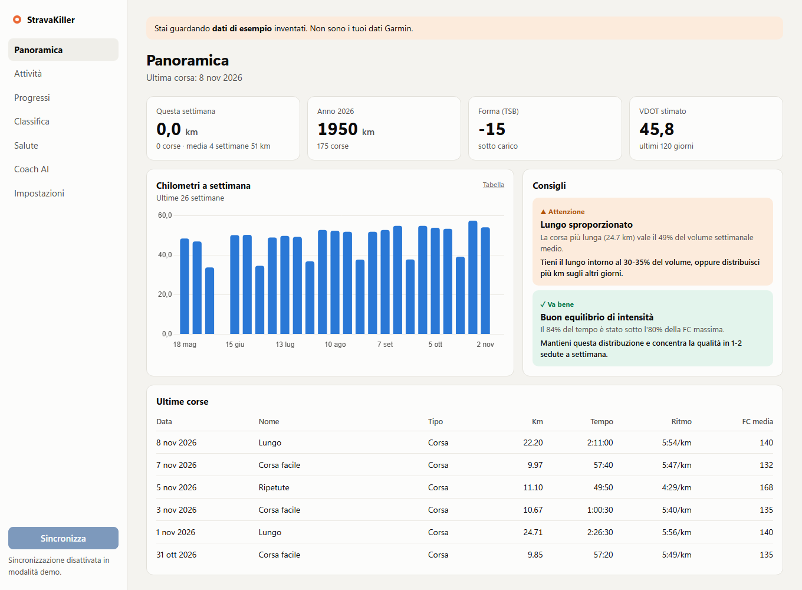
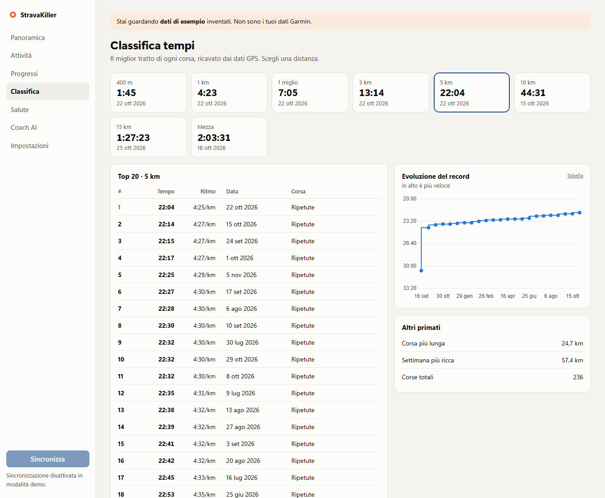
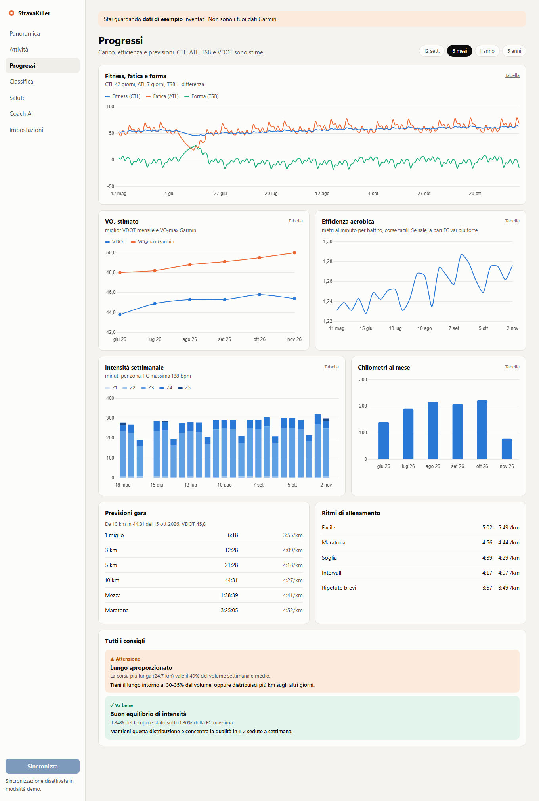
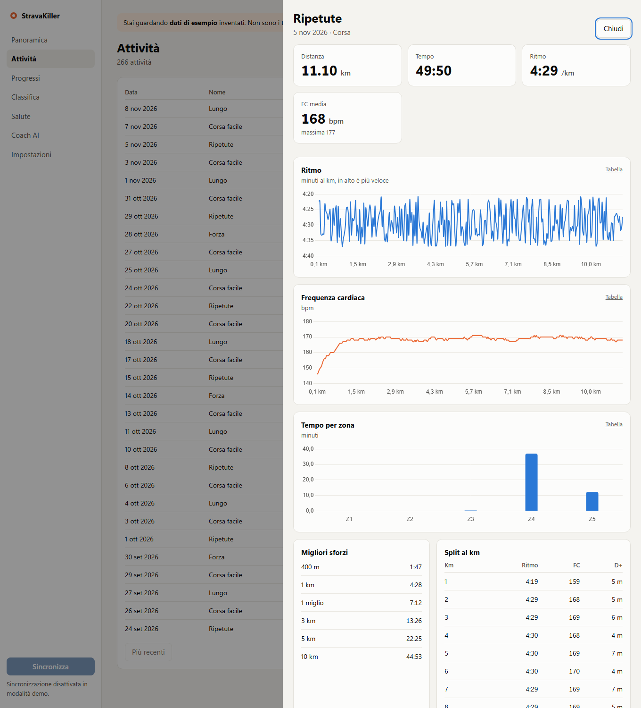
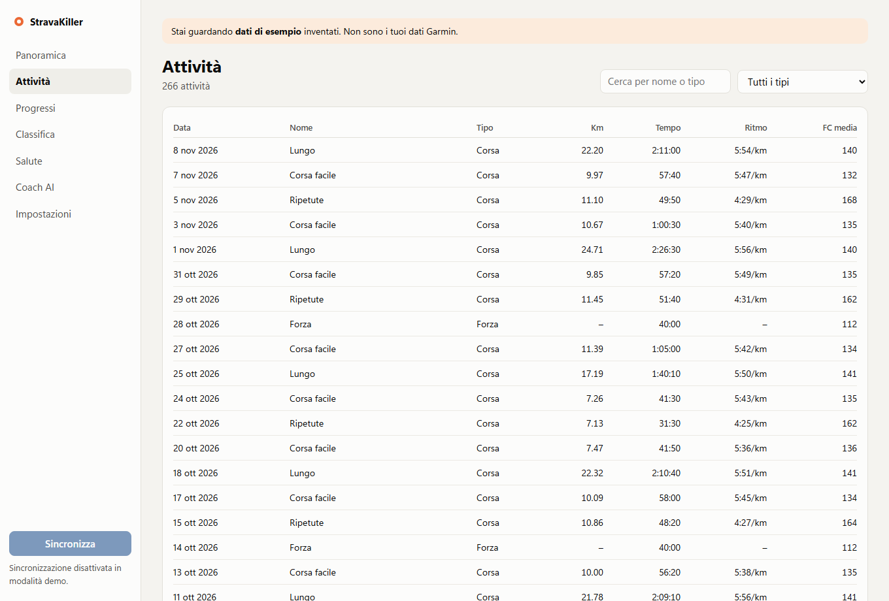
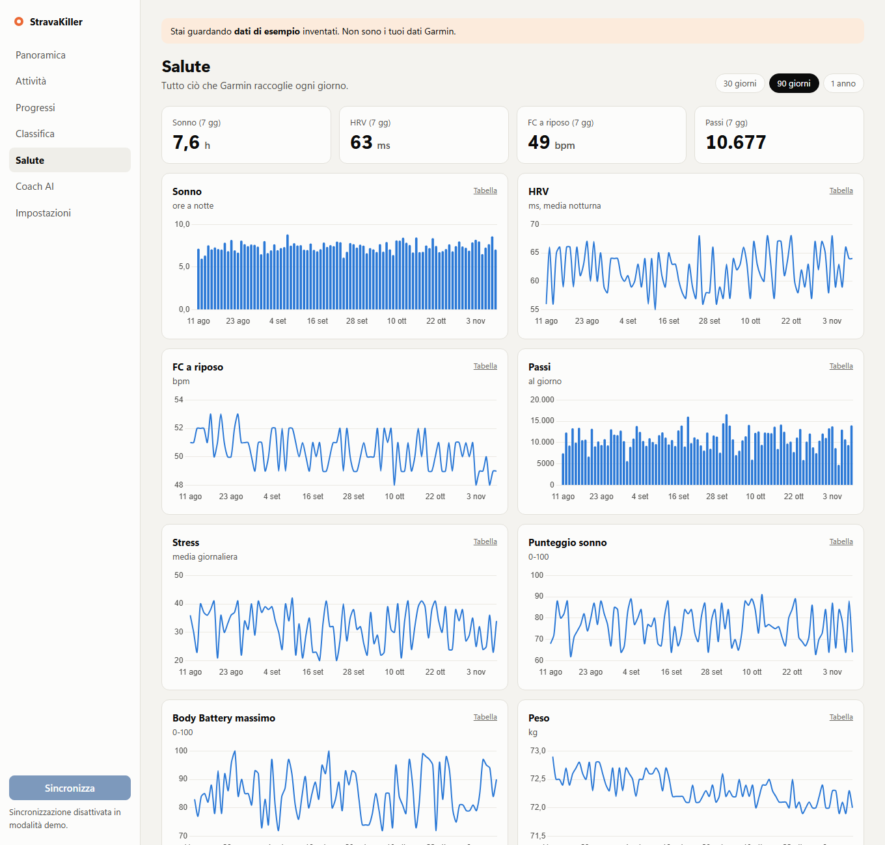
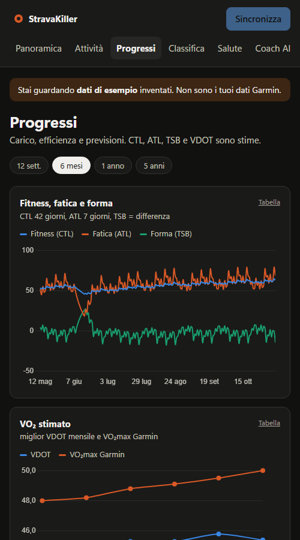
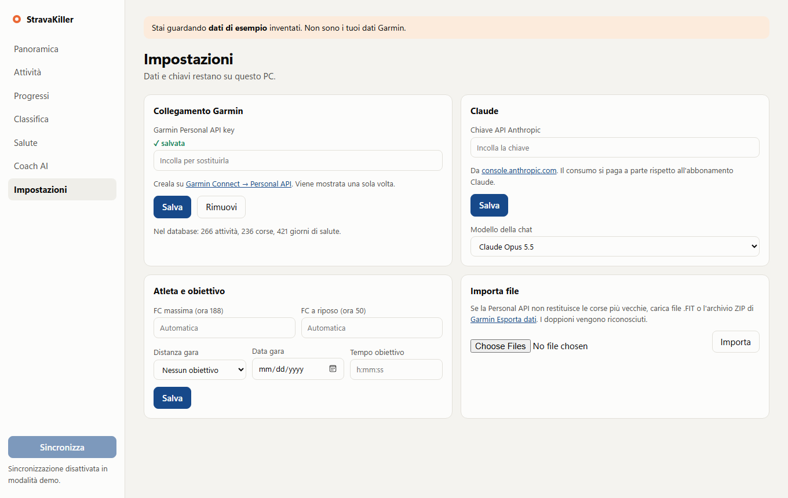

<div align="center">

# 🪦 StravaKiller

### I just killed Strava.
*(On my own laptop. With one double-click. Strava is fine. My subscription anxiety is not.)*

**Your Garmin data. Your computer. An AI coach that actually read your splits.**

**No feed. No kudos. No ads. No account. Zero people watching your Tuesday recovery jog.**

[🇮🇹 Leggi in italiano](README.it.md) · [See it](#-see-it) · [Try it in 5 minutes](#-try-it-in-5-minutes) · [Connect your watch](#-connect-your-garmin) · [Glossary](#-what-do-all-these-acronyms-mean)



</div>

> [!IMPORTANT]
> **Honest status: early and fresh out of the oven.** The dashboards, analytics and demo work and are tested. Garmin sync and the AI chat are tested only against simulated services, so **the first real sync may reveal a surprise**. If it does, please [open an issue](../../issues). The interface is currently **in Italian** 🇮🇹. Translations are welcome.

> [!NOTE]
> "StravaKiller" is a joke. This project is independent and is **not affiliated with, endorsed by, or connected to Strava or Garmin**. You need a Garmin account and your own personal API key.

---

## 🤔 What is this?

Your Garmin watch collects an absurd amount of data about you. StravaKiller downloads **your own data** to **your own computer** and turns it into something useful:

- 🏆 **A leaderboard against the only person who matters:** past you. It finds your fastest 400 m, 1 km, 5 km, 10 km, half and marathon *inside any run*.
- 📈 **Progress you can actually see:** fitness, fatigue, form, aerobic efficiency and intensity over time.
- 🔮 **Race predictions and training paces** calculated from your recent performances.
- 💡 **Advice with receipts:** every tip shows the number that triggered it. No vague "great job, champ!".
- 😴 **Health data in one place:** sleep, HRV, resting heart rate, steps, stress, Body Battery and weight.
- 🤖 **An AI coach (Claude)** that reads your data before answering. Ask *"am I overtraining?"* and get an answer with your numbers in it.

### The pitch, in one table

| | A typical social fitness app | StravaKiller |
|---|---|---|
| Where your data lives | Their servers | **A file on your PC** |
| Who sees your runs | Whoever the settings allow | **You** |
| Ads and feed | Often | **Never. There is no feed.** |
| Monthly subscription | Often | **None.** The optional AI chat is pay-per-use |
| Can you read the code? | No | **Every line** |
| Kudos | Yes | **You can give yourself one. Nobody will know.** |

---

## 👀 See it

> Every screenshot uses **made-up demo data**. Those are not anybody's real runs.

### 🏆 Leaderboard: you vs. you
Your best times at each distance, the top 20, and how each record has fallen over time.



### 📈 Progress: the "am I getting better?" page
Fitness, fatigue, form, VO₂ estimate, efficiency, intensity, race predictions, training paces and every recommendation.



### 🔍 Every run, dissected
Pace, heart rate, time in zones, best efforts and per-kilometre splits.



### 📋 All your activities
Search and filter everything, including non-running activities.



### 😴 Health
Everything your watch measures each day.



### 🌙 Dark mode and phone layout
It follows your system theme and adapts to small screens.



### ⚙️ Settings
Where you paste your keys and set your race goal.



### 🤖 The AI coach
There's no screenshot here on purpose: it needs a real API key, and a fake chat would be cheating. Things to ask it:

- *"How is my training going?"*
- *"Plan my next week based on what I've actually been doing."*
- *"Am I at risk of overdoing it?"*
- *"How can I get faster over 10 km?"*

It only has **read-only** access: it can look at your data, never change it.

---

## 🚀 Try it in 5 minutes

No Garmin account needed: the demo uses invented data. Instructions are for **Windows**, where it has been tested.

**1. Install Python.** Press the Windows key, type `PowerShell`, press Enter, and paste this:

```bash
winget install Python.Python.3.13 --scope user
```

**2. Download this project.** At the top of this page click the green **Code** button → **Download ZIP**. Then extract the ZIP (right-click → *Extract All*) somewhere simple, like your Documents folder. Avoid folders synced by OneDrive or Dropbox.

**3. Start the demo.** Open the extracted folder, click the address bar, type `powershell` and press Enter. Then paste:

```bash
powershell -ExecutionPolicy Bypass -File start.ps1 -Demo
```

The first launch installs what it needs and takes a few minutes. Then your browser opens at `http://127.0.0.1:8765`. 🎉

Keep that window open while you use the app. Close it to stop.

---

## ⌚ Connect your Garmin

**1. Get your personal key.** It's free and doesn't require any approval.
- Go to [Garmin Connect → Personal API](https://connect.garmin.com/app/settings/personalApiToken) and sign in.
- Create a key, read and accept the terms, and choose how long it lasts (up to 1 year).
- **Copy it right away: Garmin shows it only once.**

Treat the key like a password. Don't post it, don't commit it, don't paste it into chats.

**2. Start the real app.** Double-click **`Start StravaKiller.bat`**.

**3. Paste the key** into **Impostazioni** (Settings), then click **Salva** (Save).

**4. Click Sincronizza** (Sync) at the bottom left and go make a coffee. The first sync reads all your activities and two years of health data, and analyses up to 400 runs. Sync again to process the rest.

**Missing older runs?** In Settings, you can import `.FIT` files or the ZIP from Garmin's [data export](https://www.garmin.com/account/datamanagement/). Duplicates are detected.

### 🤖 Turn on the AI coach (optional)

1. Create an API key at [console.anthropic.com](https://console.anthropic.com/settings/keys).
2. Paste it in **Impostazioni** under *Claude*.
3. Open **Coach AI** and ask away.

The API is **pay-per-use and separate from any Claude subscription**. See [current prices](https://www.anthropic.com/pricing). You can choose a cheaper model in Settings.

### 💬 Ask from Claude Code (optional)

The project includes a read-only [MCP](https://modelcontextprotocol.io) server. Copy `.mcp.example.json` to `.mcp.json`, replace the two paths with yours, and open the folder in Claude Code.

---

## 🧠 What do all these acronyms mean?

Never heard of any of this? Good. Here's the short version.

| Term | In plain English |
|---|---|
| **API key** | A long password that lets this app read your Garmin data. Only you should have it. |
| **FIT file** | The file your watch records for each activity, with your position, heart rate and pace every few seconds. |
| **Heart rate zones (Z1–Z5)** | How hard you're working, from "chatting" (Z1) to "can't speak" (Z5). |
| **Training load** | How much a run stressed your body. Long and hard = big number. |
| **CTL (Fitness)** | Your average load over about 6 weeks. Goes up slowly when you train consistently. |
| **ATL (Fatigue)** | Your average load over about 1 week. Goes up fast after hard days. |
| **TSB (Form)** | Fitness minus fatigue. Very negative means you're tired; positive means you're fresh. |
| **VO₂max** | How much oxygen your body can use. A classic measure of aerobic engine size. |
| **VDOT** | A running-fitness score derived from a race-like performance, used to predict times and set paces. |
| **Aerobic efficiency** | How fast you go per heartbeat. If it climbs, you're getting fitter. |
| **HRV** | The variation between heartbeats. A drop below *your own* normal can signal poor recovery. |
| **Resting HR** | Your heart rate at rest. An unusual rise can indicate fatigue or illness. |
| **Cadence** | Steps per minute. |
| **Split** | Your time for one segment, usually a kilometre. |
| **MCP** | A standard way for AI assistants to use tools. Here it lets Claude read your stats. |

---

## 🔬 How the numbers are calculated

No black boxes. It's all in [`app/analytics.py`](app/analytics.py) and [`app/fit_files.py`](app/fit_files.py).

| Feature | Method |
|---|---|
| Leaderboard | Sliding window over each run's FIT data for the fastest stretch; pauses excluded, GPS spikes rejected |
| Training load | Banister TRIMP based on heart-rate reserve |
| CTL / ATL / TSB | Exponential averages over 42 and 7 days; TSB is yesterday's CTL − ATL |
| VDOT and predictions | Daniels–Gilbert formulas, from your best ≥ 5 km effort in the last 120 days |
| Zones | Percentage of max heart rate, recalculated if you change it |
| Advice | Transparent rules, each showing the number that triggered it |

These are **estimates to guide your training, not medical advice**. Efforts inside a training run usually underestimate your race potential. If something hurts, see a professional, not a dashboard.

---

## 🔒 Privacy

- 🏠 Database and keys are stored locally in `%LOCALAPPDATA%\GarminCoach`, never in this project folder.
- 🚪 The app listens only on your own computer and rejects requests from other websites.
- 📖 Garmin access is read-only.
- 📡 Your data leaves your PC only to reach Garmin (to download it) and, **if you use the AI chat**, Anthropic (the parts of your data needed to answer you).
- ⚠️ **On a work computer**, your company's network tools may be able to inspect this traffic. Use a personal machine for personal health data.

---

## 🆘 Something went wrong?

| Problem | What to do |
|---|---|
| **`CERTIFICATE_VERIFY_FAILED` when syncing** | Usually a corporate network inspecting traffic (e.g. Zscaler). The app refuses the connection to protect your key. Use a personal computer. |
| **"Python not found"** | Run step 1 of the demo instructions, then open a new window. |
| **HTTP 401 or 403 from Garmin** | Your key is wrong or expired. Create a new one and paste it in Settings. |
| **HTTP 429 from Garmin** | Too many requests. What was downloaded is saved; try again later. |
| **Some charts are missing** | Garmin may not provide that metric for your watch or through this API. |
| **The page doesn't load** | Check the black window is still open and has no errors. Port 8765 must be free. |
| **Windows warns about the script** | The code is all here for you to read. Run it only if you're comfortable with that. |

---

## ⚠️ Known limits

- UI in Italian only, for now.
- Tested on Windows. macOS and Linux should work by running `uvicorn` manually, but they're **untested** and the start script is PowerShell-only.
- Running-focused: other sports are listed but not analysed in depth.
- Read-only: it can't send workouts to your watch, because Garmin's personal API doesn't allow it.
- Personal use: everyone runs their own copy with their own key. It's not a hosted service. Please read Garmin's terms when creating your key, including what they say about AI.

---

## 🛠️ For developers

Python · FastAPI · SQLite · vanilla JS · Chart.js · Anthropic SDK · MCP. **No build step.**

```text
app/
  sync.py        Garmin Personal API sync and FIT import
  fit_files.py   FIT parsing, best efforts, splits, zones
  analytics.py   Metrics, leaderboard, recommendations
  coach.py       Streaming Claude chat with tools
  tools.py       Read-only tools shared by chat and MCP
  mcp_server.py  Local MCP server
  demo.py        Made-up data generator
  main.py        Local API (localhost only)
  static/        Web interface
tests/           Tests that need no network or keys
```

```bash
python -m unittest discover -s tests -t .
```

Issues and pull requests are welcome, especially **real-world Garmin sync reports**, English translations, and macOS/Linux start scripts.

## 📄 License

[MIT](LICENSE). Do what you want. Run far.

<div align="center">

**If this made you laugh or run faster, leave a ⭐. It's the only kudos we accept.**

</div>
